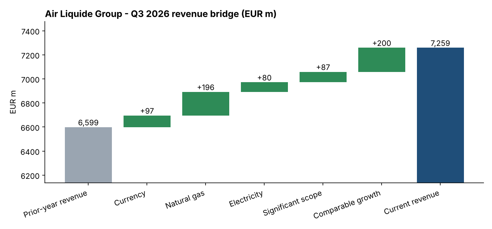
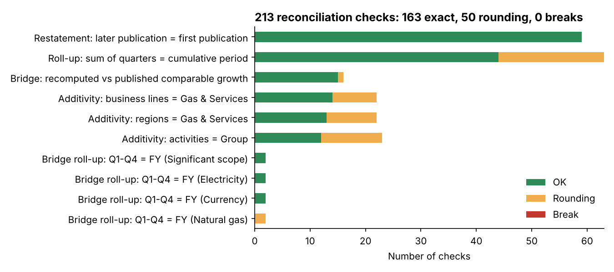

# Air Liquide – Revenue Bridge & Reconciliation Cockpit (Power BI)

**Can corporate finance trust consolidated revenue across reports, restatements and reorganisations, and what really drives growth?**

This project uses **Air Liquide's real published figures** (7 official press releases, Q1 2024 to Q3 2026) to build a Power BI product that does two things a corporate finance BI team does every closing:

1. **Revenue bridge.** It explains the move from last year's revenue to this year's: currency, energy pass-through (natural gas and electricity), significant scope (acquisitions and divestitures), the 2025 internal transfer, and **comparable (organic) growth**.
2. **Data reconciliation.** It runs **213 automated checks** to prove the consolidated figures add up, roll up and stay identical from one publication to the next. This is the kind of control you need to guarantee *continuité de service et conformité des données consolidées* during a reporting-system migration.

> All data is public and comes from Air Liquide's investor press releases (links below). No synthetic data.

---

## Key findings

| # | Finding | Why it matters for finance |
|---|---|---|
| 1 | **213 checks: 163 exact matches, 50 rounding differences (max ±€1m), 0 breaks.** | The published consolidated data is internally consistent. Differences come only from rounding to €1m, so a reconciliation tool must allow a rounding tolerance or it will raise false alarms. |
| 2 | **Q3 2026: published growth +10.0%, comparable growth only +3.0%.** Of the +€660m increase, €276m is energy pass-through, €97m currency and €87m scope. Only €200m is organic. | Headline growth can overstate performance about 3x. Management dashboards must show the bridge, not just the total. |
| 3 | **FY 2025: published −0.4%, comparable +2.0%.** A €887m currency headwind hid €537m of organic growth. | The opposite case: a negative headline hid a positive underlying trend. |
| 4 | **2025 internal transfer (GM&T → Industrial Merchant): +€396m inside Gas & Services, €0 at Group level.** 2024 comparatives were *not* restated. Without the transfer, Gas & Services published growth for FY 2025 would be about −0.5% instead of +1.1%. | A reclassification changes segment totals without changing the Group total. That is exactly what a migration or re-mapping can do, and why segment-level checks are needed. |
| 5 | **The comparable growth recalculated from the published € impacts matches the reported % in 16/16 cases** (within 0.06 pt). | The bridge logic in the model is correct and auditable. |
| 6 | **Region names changed between documents** ("Europe, Middle East & Africa (EMEA)", "Europe, Middle East & Africa", "EMEA", "Europe"). | Master-data mapping is a prerequisite to any consolidation. It is logged in `data/clean/log_label_mapping.csv`. |




---

## What's in the Power BI file

| Page | Content |
|---|---|
| **1. Revenue Bridge** | Waterfall (prior-year → currency → energy → scope → transfer → comparable → current), KPI cards, and a table checking the recalculated vs the reported comparable growth |
| **2. Reconciliation** | Check KPIs (total / exact / rounding / breaks / pass rate), results by check type, a live DAX check (regions and business lines vs Gas & Services total), and a drill-down check log |
| **3. Revenue Breakdown** | Revenue by region and business line, with published growth recalculated in DAX |

**Data model (star schema):** 3 fact tables (`fact_revenue`, `fact_bridge`, `fact_checks`) and 3 dimensions (`dim_period`, `dim_segment`, `dim_source`). **29 DAX measures** (see [`powerbi/measures.dax`](powerbi/measures.dax)). **Row-Level Security:** 3 roles (*Regional Controller – Americas / EMEA / Asia Pacific*), so each controller sees only their region.

---

## How it was built

```
data/raw/      → exactly what the press releases say (transcribed, labels as published, with source IDs)
scripts/clean_and_check.py → label mapping, period keys, "golden record" selection, bridge, 213 checks
data/clean/    → star-schema tables loaded by Power BI
scripts/build_pbip.py      → generates the Power BI project (model, measures, RLS, pages)
powerbi/       → AirLiquide_Revenue_Cockpit.pbip (open with Power BI Desktop)
docs/          → project report, user stories, charts
```

**Golden-record rule:** when the same figure appears in several documents, the model uses its first publication as the period itself, and falls back to the earliest prior-year comparative for 2024. All other versions are kept and compared (restatement check).

**Derived values (flagged `is_derived = 1`):** comparable growth in € (residual of the bridge); Q4 2025 Gas & Services internal transfer (= FY 2025 − Q1−Q3 2025 = €118m, not printed in the Q4 section); FY 2024 Group revenue for the bridge (= sum of the 2024 quarters).

## How to run it

1. `pip install pandas matplotlib`, then `python scripts/clean_and_check.py` (rebuilds `data/clean`).
2. Open `powerbi/AirLiquide_Revenue_Cockpit.pbip` in **Power BI Desktop**.
3. **Transform data → Edit parameters → `DataFolder`** = the full path to your `data/clean/` folder (ending with `\`), then **Refresh**.
4. Test security: **Modeling → View as → Regional Controller – Americas**.

## Sources (Air Liquide investor press releases)

| ID | Document | Date |
|---|---|---|
| S1 | [Q1 2025 revenue](https://airliquide.com/sites/airliquide.com/files/2025-04/building-its-resilience-air-liquide-staying-course-first-quarter-2025_6809c974ec55f.pdf) | 24 Apr 2025 |
| S2 | [H1 2025 results](https://cdn.financialreports.eu/financialreports/media/filings/1089/2025/ISS/1089_iss_2025-07-29_3e15897e-0480-474f-9e62-8d78acb004ae.pdf) ([official page](https://www.airliquide.com/investors/first-half-2025-results)) | 29 Jul 2025 |
| S3 | [Q3 2025 revenue](https://www.airliquide.com/sites/airliquide.com/files/2025-11/air-liquide-pr-25-q3-air-liquide-continues-to-combine-sales-growth-with-commercial-successes-to-shape-the-future.pdf) | 28 Oct 2025 |
| S4 | [FY 2025 results](https://www.airliquide.com/2025-annual-results) | 20 Feb 2026 |
| S5 | [Q1 2026 revenue](https://www.airliquide.com/sites/airliquide.com/files/2026-04/growth-performance-and-record-investments-air-liquide-continues-its-successful-trajectory-q1-2026_69f0437ea8b49.pdf) | 28 Apr 2026 |
| S6 | [H1 2026 results](https://www.airliquide.com/sites/airliquide.com/files/2026-07/h1-2026-results-acceleration-second-quarter-air-liquide-combines-growth-continuous-performance_6a683bddd0a4b.pdf) | 28 Jul 2026 |
| S7 | [Q3 2026 revenue](https://www.webdisclosure.com/press-release/q3-2026-air-liquide-accelerates-driven-by-sales-growth-and-the-launch-of-its-strategic-plan-l6M49P5A7DA) | 29 Oct 2026 |

Full list with URLs: [`data/raw/sources.csv`](data/raw/sources.csv). Detailed write-up: [`docs/PROJECT_REPORT.md`](docs/PROJECT_REPORT.md).

## Limitations

- Public data only: quarterly, at the level of region and business line. A real corporate BI layer works at entity × account × month level, from the consolidation system.
- The figures were transcribed manually from the PDFs. Two items are marked *to verify* in the raw file (the Q3 2026 Healthcare comparable %, and the "Europe" label in the Q3 2026 year-to-date table).
- This is an independent portfolio project, not affiliated with or endorsed by Air Liquide.

*Author: Waqas Saleem, Environmental & Energy Engineer | Data & BI ([GitHub](https://github.com/waqassaleem1304))*
