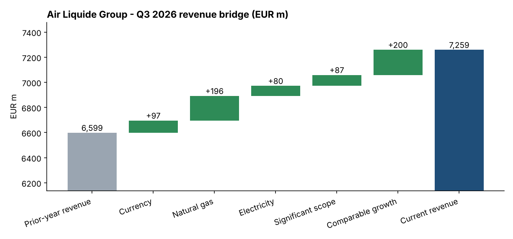
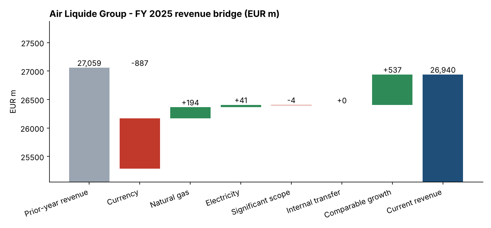
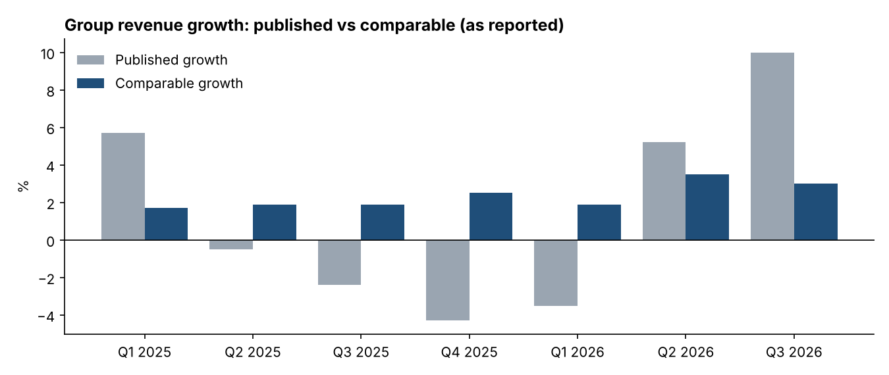

# Project report: Air Liquide Revenue Bridge & Reconciliation Cockpit

## 1. Objective

Build a Power BI product that a **corporate finance team** could use at each quarterly closing to answer two questions:

1. **"What really drove revenue this quarter?"** Split published growth into currency, energy pass-through, scope, internal transfers and comparable (organic) growth.
2. **"Can we trust the consolidated numbers?"** Prove automatically that the figures add up (segments = total), roll up (quarters = half-year / nine months / year) and stay stable from one publication to the next (no silent restatement).

The second question is the core control behind any **reporting-system migration**: before and after a source system changes, the consolidated figures must be identical, or the differences must be explained.

## 2. Users and user stories (product backlog)

| ID | As a… | I want… | So that… | Acceptance criteria |
|---|---|---|---|---|
| US1 | Group CFO / FP&A | to see the revenue bridge for any quarter | I can explain the published vs comparable gap to the board | Waterfall shows prior-year, currency, energy, scope, transfer, comparable and current; the steps sum to current revenue |
| US2 | Ops Control (closing team) | a list of every reconciliation check with its status | I can sign off the closing quickly | Each check shows expected, actual, difference and status; rounding (≤ €2m) is separated from breaks |
| US3 | Ops Control | the comparable growth recalculated from € impacts | I can detect an error in the published % | Recalculated vs reported gap shown in points; flagged if > 0.1 pt |
| US4 | Regional controller | to see only my region | confidential data is protected | RLS role per region; "View as" shows only that region |
| US5 | BI Product Owner | label mapping and derived values logged | the model is auditable | `log_label_mapping.csv` and `is_derived` flags exist |
| Next | Group CFO | an alert when a new quarter breaks a check | issues are caught before publication | *Backlog: Power BI data alert / Power Automate* |

## 3. Data

- **Source:** 7 Air Liquide press releases and activity reports (Q1 2025 → Q3 2026), each also containing prior-year comparatives, so the data covers Q1 2024 → Q3 2026. See `data/raw/sources.csv`.
- **Why public data:** internal ledgers are confidential. Published consolidated figures are the real end product of a corporate BI and consolidation chain, so checking them reproduces the same controls.
- **Raw layer (`data/raw`):** figures transcribed as published, with original labels, source ID, role (*Reported period / Prior-year comparative / Quarterly table*) and notes. 232 revenue rows and 74 bridge rows.

## 4. Method

### 4.1 Cleaning (`scripts/clean_and_check.py`)
1. **Label harmonisation:** 4 different spellings of the EMEA region and 2 of "Group" are mapped to one master list, and the mapping is logged.
2. **Keys and dimensions:** `period_key` (for example `2026-Q3`) with period type, year, end date and sort order. `segment_key` with a hierarchy (Group → Activity; Gas & Services → Region / Business line).
3. **Golden record:** one reference figure per period × segment (first publication of that period). The other versions are kept for the restatement check.
4. **Bridge:** prior-year revenue + Σ published impacts + *comparable growth (residual)* = current revenue. Derived values are flagged.

### 4.2 Reconciliation checks (213)

| Check | Rule | Count |
|---|---|---|
| Additivity | Σ regions = Gas & Services; Σ business lines = Gas & Services; G&S + E&T = Group (each table, each document) | 67 |
| Restatement | Same period × segment in a later document = first publication | 59 |
| Period roll-up | Q1+Q2 = H1; Q1+Q2+Q3 = 9M; Q1…Q4 = FY | 63 |
| Bridge roll-up | Σ quarterly impacts = full-year impact (currency, gas, electricity, scope) | 8 |
| Bridge vs reported | Comparable growth recalculated from € impacts = comparable % printed | 16 |

**Status rule:** difference 0 → *OK*; ≤ €2m (or ≤ 0.15 pt) → *Rounding*; otherwise → *Break / Investigate*.

### 4.3 Power BI
- **Star schema:** `fact_revenue`, `fact_bridge`, `fact_checks` and `dim_period`, `dim_segment`, `dim_source` (single-direction 1-to-many relationships).
- **DAX (29 measures):** reference revenue, prior-year via `REMOVEFILTERS` on the period dimension, growth recalculated vs as-reported, live segment-vs-total check (`Regions Check Diff`), restatement spread (`SUMX` over `SUMMARIZE`), bridge components, and check KPIs.
- **Power Query:** one `DataFolder` parameter, so the CSV location changes without editing queries.
- **RLS:** `Regional Controller – Americas / EMEA / Asia Pacific`, filtering `dim_segment` and the check log.

## 5. Results

- **0 breaks in 213 checks.** 50 rounding differences, all ±€1m. The published data is consistent, and the tool correctly separates rounding from real errors.
- **Q3 2026:** +€660m published growth (+10.0%). Energy +€276m, currency +€97m, scope +€87m. Comparable growth is only +€200m (+3.0%).
- **FY 2025:** −0.4% published, but +2.0% comparable, because of a −€887m currency effect.

- **Internal transfer 2025:** +€396m moved into Gas & Services (from Engineering & Technologies), neutral for the Group. 2024 was not restated, so G&S published growth (+1.1%) includes about +1.5 pt of reclassification.
- **Derived Q4 2025 transfer:** €118m (FY €396m − Q1–Q3 €278m). It is consistent with the 2.5% G&S comparable growth printed for Q4.

## 6. Limitations and next steps
- Quarterly public data, with no entity/account/month detail and no actual ERP or consolidation extract.
- Manual transcription: 2 values flagged *to verify* against the PDF.
- **Next sprint ideas:** add Q4 2026 when published; add OIR margin; automate PDF extraction; publish to Power BI Service with scheduled refresh and data alerts; extend the reconciliation to a source-vs-target migration test (old vs new data source).
